<p align="center">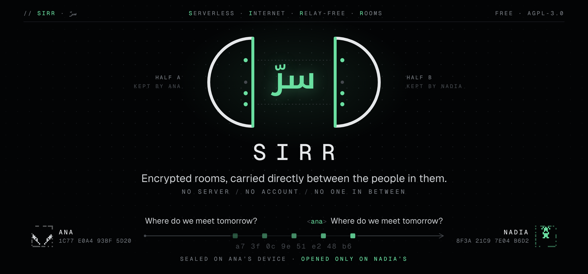</p>

<p align="center">
  <a href="https://github.com/CRTnoise/sirr/releases/latest"></a>
  <a href="https://github.com/CRTnoise/sirr/releases"></a>
  <a href="LICENSE"></a>
</p>

<!-- Download links name this release's files: on a new release, replace 1.2.0 below with the new version. -->
<table align="center">
<tr>
<td align="center"><a href="https://github.com/CRTnoise/sirr/releases/latest/download/Sirr-Setup-1.2.0.exe">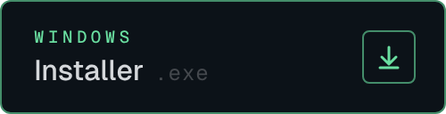</a><br></td>
<td align="center"><a href="https://github.com/CRTnoise/sirr/releases/latest/download/Sirr-1.2.0-portable.exe">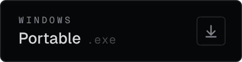</a><br></td>
</tr>
<tr>
<td align="center"><a href="https://github.com/CRTnoise/sirr/releases/latest/download/Sirr-1.2.0-x86_64.AppImage">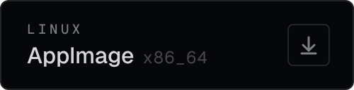</a><br></td>
<td align="center"><a href="https://github.com/CRTnoise/sirr/releases/latest/download/Sirr-1.2.0-amd64.deb">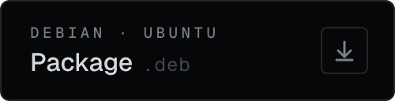</a><br></td>
</tr>
</table>

<p align="center"><sub>Free, no account. Builds aren't code-signed yet: check the file against <code>SHA256SUMS.txt</code> on the <a href="https://github.com/CRTnoise/sirr/releases/latest">release page</a> · older versions under <a href="https://github.com/CRTnoise/sirr/releases">Releases</a> · or <a href="#from-source">build from source</a>.</sub></p>

# Sirr

**Serverless, end-to-end encrypted rooms for text, voice, files and screen share being carried directly between the devices of the people in them.**

No servers. No accounts. No phone number. Nobody in the middle who can be ordered to hand over your messages, because there is no middle.

> *Sirr* (سرّ) is Arabic for a secret, a well guarded one that is kept between two. SIRR is also: **S**erverless **I**nternet **R**elay-free **R**ooms.

---

## What it is

- **Rooms** are rendezvous points on the [Hyperswarm](https://github.com/holepunchto/hyperswarm) DHT. Everyone holding a room's code connects directly to everyone else in it.
- **Identity** is an X25519 key pair generated on your device. Your fingerprint is derived from its public half; there is nothing to register.
- **Everything is end-to-end encrypted** — messages, voice, files, names, pins, typing — on top of Hyperswarm's Noise-encrypted links, never trusting the link itself: a fresh key for every message (hash ratchet), a new key exchange every ten minutes, forward-secret from the first byte.
- **Voice, video and screen share** run peer to peer (WebRTC, or audio over the swarm link itself when WebRTC can't connect).
- **Files** stream peer to peer and are written to disk encrypted.
- **Everything on disk is encrypted**: history, room codes, contacts and received files, under a key protected by the operating system keychain.
- **Disappearing messages**, offline history sync between members, verified relays of messages you missed, room ownership and moderation, DMs and contacts.
- **Gets through when the network fights back**: remembered entry points, volunteer blind relays, WebSocket bridges that look like ordinary HTTPS, and **Nearby** - a LAN (and experimental Bluetooth) mesh for when there is no internet at all.
- **Echoes**: a message for someone who's offline can wait *inside the DHT itself* - no server and no member holding it - and stays alive only as long as members keep listening for it.
- **App lock with a duress passphrase**, panic wipe, room eviction, padded traffic, optional cover traffic.

## A look

<p align="center">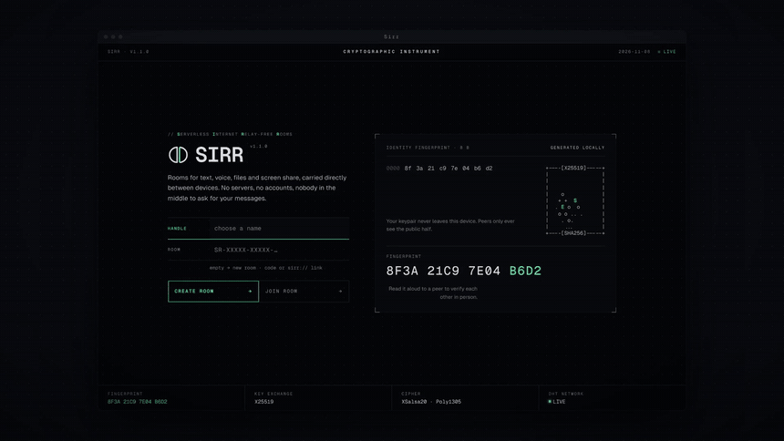</p>

| | |
| --- | --- |
| 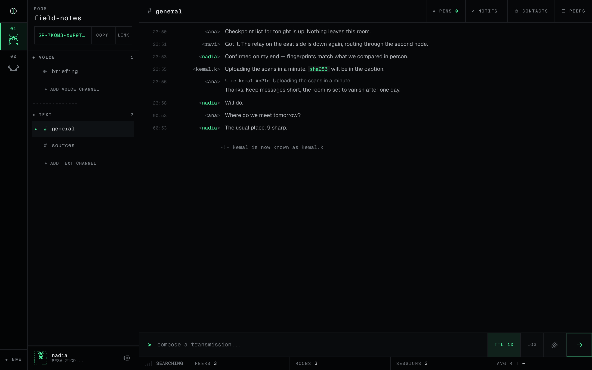 | 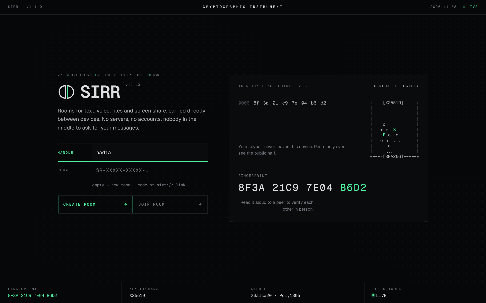 |
| **Rooms, IRC style.** One line per message; renames reach every line at once. | **No account.** Your identity is a key generated on your device. |
| 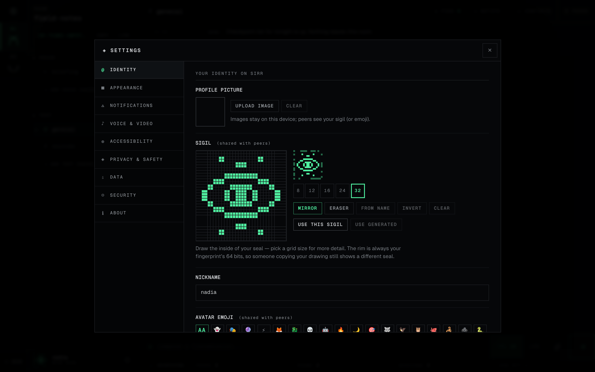 | 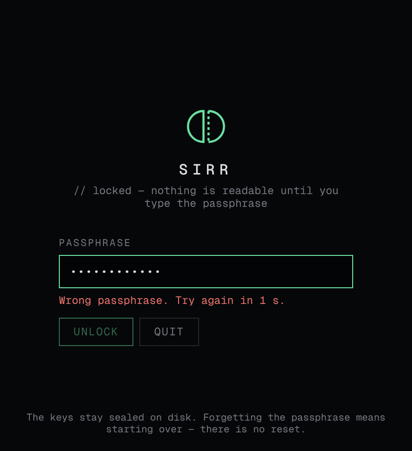 |
| **Sigils.** Drawn by your name or by you; the rim is always your fingerprint. | **App lock.** Passphrase over the OS keychain, with a duress passphrase. |
| 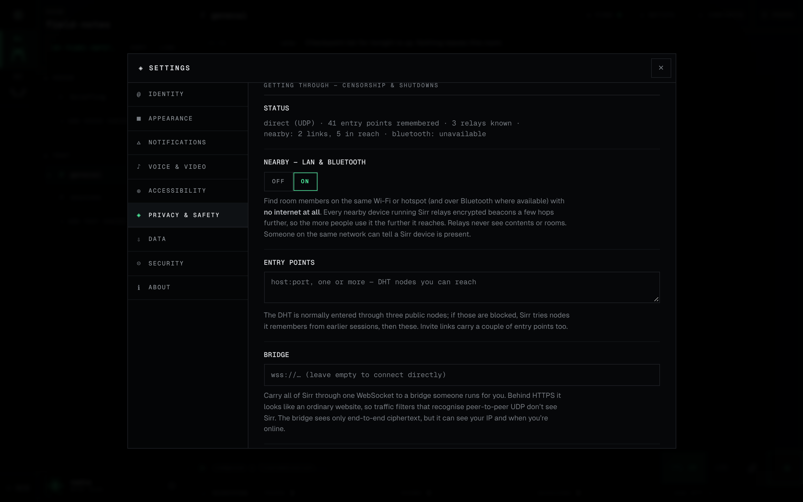 | 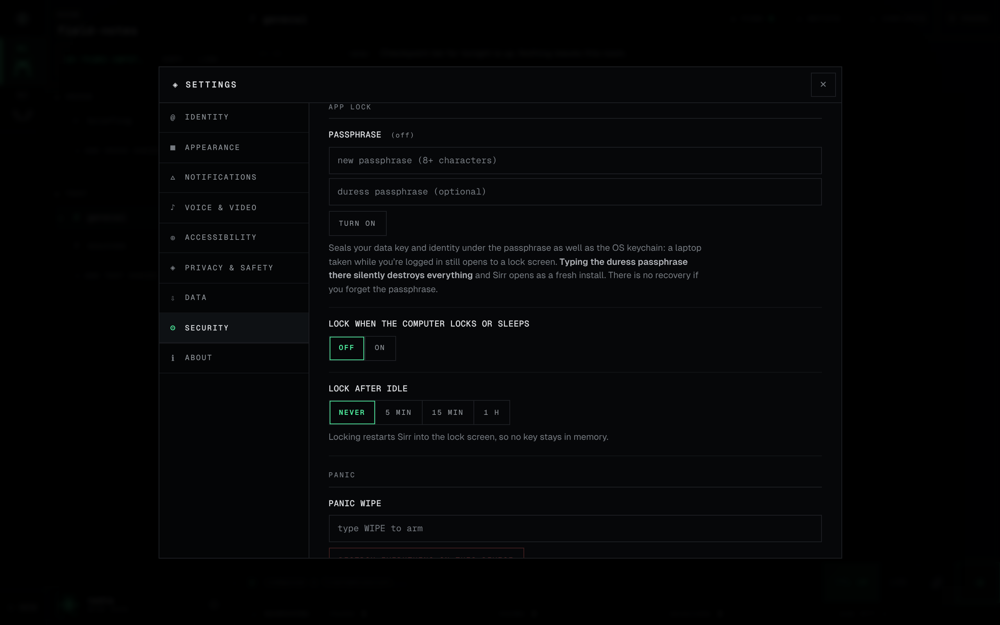 |
| **Getting through.** Entry points, bridges, relays, nearby. | **Panic.** Lock, wipe, shortcut. |

### How it gets through

<p align="center">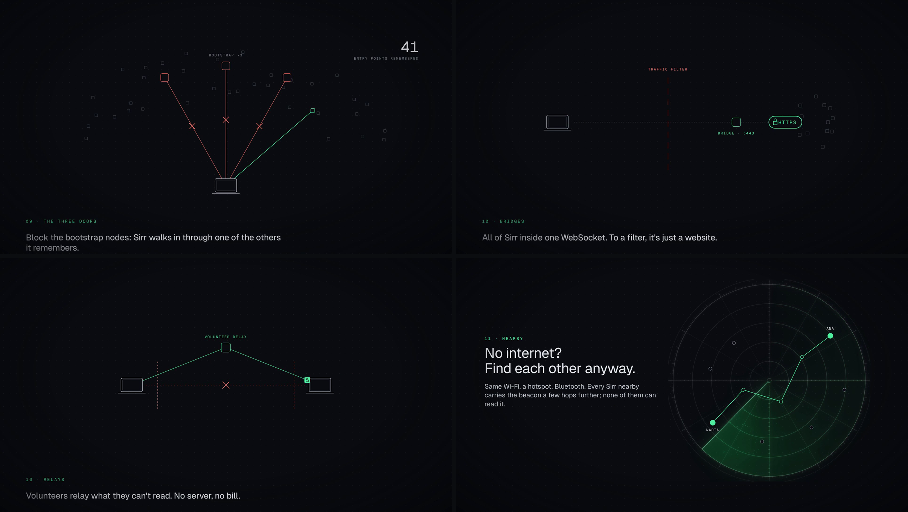</p>

### Echoes: offline delivery with no one holding the message

<p align="center">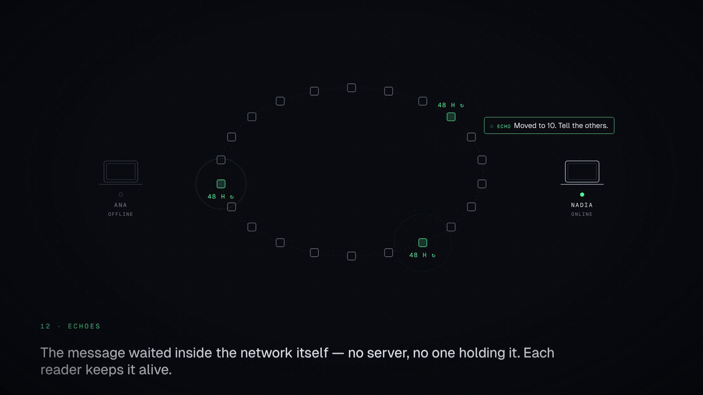</p>

## Who it is for

People who need to talk without asking anyone's permission: journalists and their sources, organisers, communities on networks that get watched or switched off, families split across borders. Sirr is built to have **no central point to block, subpoena or shut down** - and to say plainly what it does *not* protect against (below).

## What it protects - and what it doesn't

**Protected**

- Message content, files and voice from everyone except the room's members.
- Your history at rest when the device is taken powered off: the data key is sealed by the OS keychain, which opens with your login. Use full-disk encryption and a strong login password as well.
- Your data on a seized, logged-in laptop, with the app lock on - and under coercion, with the duress passphrase.
- Past sessions if your identity key is later stolen (forward secrecy) - and the thief still can't pose as other people to you.
- Your room list: peers learn only the rooms they share with you. Your name and status: only people who completed the handshake with you see them.
- Who's talking, from someone watching your connection: payloads are padded, and cover traffic is one switch away.

**Not protected - know this before you rely on it**

- **Your IP address is visible to the people you talk to.** Connections are direct; relays and bridges help you *reach* people, they don't hide you (no onion routing). Anyone in a room learns the IP of every member who is online.
- **A room is only as private as its code.** Anyone with the code is a member. The owner can remove someone by moving everyone else to a new code (`/evict nick`).
- **Echoes are opt-in for a reason**: they're sealed with a key from the room code, not a forward-secret session.
- **Members can keep what they receive.** Disappearing messages are deleted by well-behaved clients; nothing stops a member from copying them first.
- **Fingerprints are 64 bits.** Comparing them in person defeats casual impersonation, not a state-level adversary with large compute. See [SECURITY.md](SECURITY.md).
- **A compromised device is compromised.** Malware on your machine can read what you read.

The full threat model, the protocol and the list of known limitations are in [SECURITY.md](SECURITY.md) and [docs/PROTOCOL.md](docs/PROTOCOL.md); what's left to build is in [ROADMAP.md](ROADMAP.md).

## Install

Download from the buttons at the top, or any version from [Releases](https://github.com/CRTnoise/sirr/releases): a Windows installer and portable `.exe`, a Linux AppImage and a `.deb`, each with `SHA256SUMS.txt`. Builds are not code-signed yet, so verify the checksum before running:

```sh
sha256sum -c SHA256SUMS.txt --ignore-missing     # Linux
certutil -hashfile Sirr-Setup-1.2.0.exe SHA256    # Windows: compare with SHA256SUMS.txt
```

On Linux: `chmod +x Sirr-*.AppImage` and run it, or `sudo apt install ./Sirr-*-amd64.deb`.

### From source

Requires Node.js 22 or later.

```sh
npm ci
npm start
```

Build installers:

```sh
npm run build:linux   # AppImage
npm run build:win     # portable .exe
npm run build:mac     # .dmg
```

On Linux, install a keyring (`gnome-keyring` or `kwallet`) so the data key can be sealed by the OS. Without one, Sirr still encrypts everything, but the key sits in a `0600` file next to the data and the app warns you.

## Develop

```sh
npm run test:all            # protocol, crypto, storage, transfers, privacy, hardening
npm run preview             # screenshots of the UI with stub data (needs Playwright)
```

`dev/preview-stub.js` stands in for the preload bridge, so the renderer can be opened in a plain browser for UI work without Electron or a network. `test/voice-harness/` drives the real voice stack in several headless tabs.

### Layout

```
main.js              Electron main process: IPC surface, windows, OS integration
preload.js           the only bridge between the UI and main (window.sirr)
lib/
  crypto-layer.js    identity, forward-secret sessions, per-room signing keys
  network.js         Hyperswarm rooms, wire protocol, membership proofs
  roomcode.js        room codes and invite links
  storage.js         rooms, contacts, history; sealed by vault.js
  vault.js           at-rest encryption
  transfers.js       BOLT file transfer (bolt.js framing)
  core-events.js     every "is this peer allowed to…" decision
  backup.js          passphrase-sealed backups
  netguard.js        SSRF guard for the opt-in link preview
  applock.js         app lock, duress passphrase, panic wipe
  roommove.js        owner-signed room moves (rekey / eviction)
  echoes.js          offline delivery in DHT mutable records
  pathways.js        entry points, volunteer relays, bridges
  nearby.js          mesh over nearby links (beacons, circuits)
  nearby-lan.js      LAN carrier · nearby-ble.js  Bluetooth LE carrier (experimental)
bin/sirr-bridge.js   run a bridge on any server
renderer/            the UI (no Node access, sandboxed, strict CSP)
test/                node test suites and the voice harness
```

## Relays and bridges at zero cost

Nobody runs infrastructure for Sirr, and nothing here costs money:

- **Volunteer relays.** Anyone can tick *Help others connect*. Their app then relays encrypted streams for up to 24 people who can't reach each other directly, under a new key each launch, found through a DHT topic that rotates daily. Relays see ciphertext and IPs, never content or rooms. The pool is as big as the number of people willing to share some bandwidth.
- **Bridges.** For networks that block or throttle peer-to-peer traffic: `node bin/sirr-bridge.js --port 49443` on any reachable machine (a free-tier VM, a home server with a forwarded port), behind a TLS reverse proxy on :443. To a filter it's an ordinary HTTPS site with a WebSocket. Pass the `wss://` address by hand, or let invites carry it. A bridge sees your IP, the handshake (including your identity's public key) and the size and timing of what you send — never the content, names or voice, and it can't inject anything.
- **Entry points.** Every Sirr remembers DHT nodes it has seen; invites carry a couple. If the three default bootstrap nodes are blocked, any one reachable node is enough.

## Invite links

An invite is `sirr://join/<code>`, optionally followed by `?via=` entry points. A community can host a small static page and set `inviteBase` in the config; invites then become `https://your-page/#<code>`. The code travels in the URL *fragment*, which browsers never send to the server, so the host never sees it.

## Contributing

See [CONTRIBUTING.md](CONTRIBUTING.md). Security issues: [SECURITY.md](SECURITY.md) - please don't open public issues for them.

## License

[AGPL-3.0-or-later](LICENSE). Bundled third-party components and their licenses are listed in [THIRD-PARTY-NOTICES.md](THIRD-PARTY-NOTICES.md).
